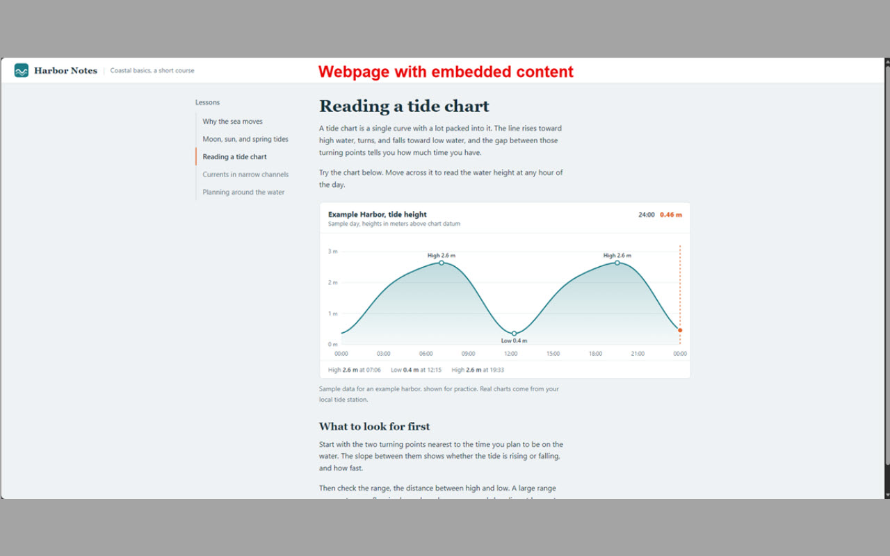
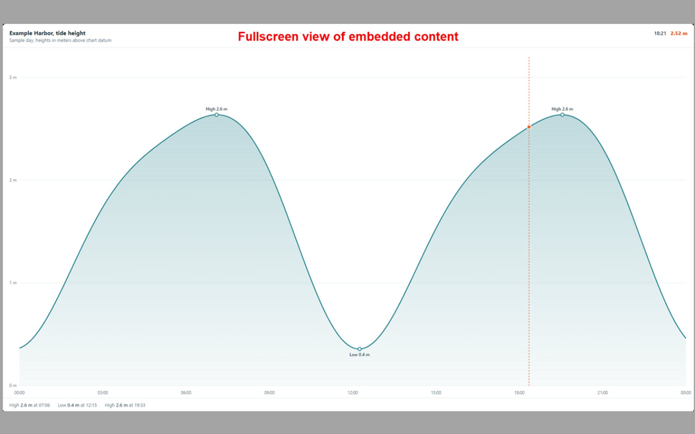

# Fullscreen Frame

Expand the largest embedded frame on any web page to fill your screen, so you can read it without the rest of the page getting in the way.

Plenty of pages embed their real content in an iframe: lessons, dashboards, charts, documents, and viewers. When the frame is small, you end up squinting at a corner of the page. Fullscreen Frame fixes that with one click or one keystroke.

## Screenshots

**Before:** a page with an interactive chart embedded in a small frame.



**After:** the same chart, expanded to fill the screen.



## How to use it

1. Open a page that contains an embedded frame.
2. Click the **Fullscreen Frame** toolbar button, or press **Alt+Shift+F**.
3. Press the shortcut again, or hit **Esc**, to go back.

If the page has more than one frame, the extension picks the largest visible one. If it can't find a frame, it shows a short message on the page.

You can change the keyboard shortcut at `edge://extensions/shortcuts` (Edge) or `chrome://extensions/shortcuts` (Chrome).

## Install

### From a store

Store listings are coming. Until then, use the manual install below.

### Manually (Edge or Chrome)

1. Download or clone this repository.
2. Open `edge://extensions` (Edge) or `chrome://extensions` (Chrome).
3. Turn on **Developer mode**.
4. Click **Load unpacked** and select the `fullscreen-frame-edge` folder, the one that contains `manifest.json`.
5. Pin the extension from the puzzle-piece menu if you'd like the button in your toolbar.

> **Tip:** To use it on local `file://` pages, open the extension's **Details** page and turn on **Allow access to file URLs**.

## Permissions and privacy

The extension asks for two permissions, and uses each one narrowly:

| Permission | Why it's needed |
| --- | --- |
| `activeTab` | Lets the extension act on the page you're viewing, only when you click the button or use the shortcut. |
| `scripting` | Runs one small function on that page to find the largest frame and expand it. |

It has no access to your other tabs, makes no network requests, and collects, stores, and shares nothing. See the full [privacy policy](PRIVACY.md).

## How it works

When you trigger it, the extension injects a small function into the current page that:

1. Looks for `iframe` and `frame` elements and picks the largest visible one.
2. Calls the browser's standard `requestFullscreen()` on it.
3. If the browser blocks true fullscreen, it falls back to stretching the frame over the whole viewport, and restores it when you trigger the extension again.

The whole thing is under 60 lines in [`background.js`](fullscreen-frame-edge/background.js), so it's easy to read and adapt.

## Project layout

```
fullscreen-frame-edge/
├── manifest.json      Extension manifest (Manifest V3)
├── background.js      The click and shortcut handler, plus the injected function
├── icons/             Toolbar and store icons
└── screenshots/       Images used in this README and the store listings
```

The extension uses Manifest V3, so the same files work in Microsoft Edge and Google Chrome.

## License

[MIT](LICENSE)
